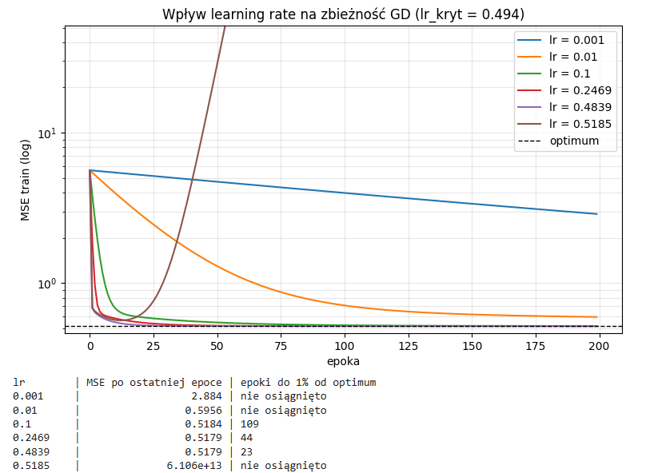
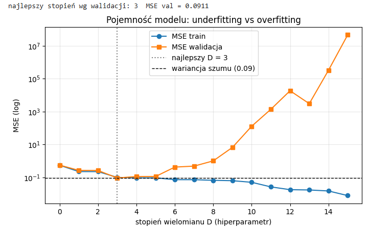

# L1, raport: środowisko, tensory i gradient

Notebook: [Lab01_rozwiazanie.ipynb](Lab01_rozwiazanie.ipynb), uruchomiony w Colab na GPU T4. Screeny są w [screeny/](screeny). Z L1 nic nie jest obowiązkowe w sprawozdaniu końcowym, więc to krótkie podsumowanie wyników.

## Wyniki

| Zadanie | Co zrobione | Wynik |
|---|---|---|
| 1.1 | standaryzacja batcha per kanał w TF (NHWC) i PyTorch (NCHW) | średnie 0, std 1, TF i PyTorch zgodne |
| 1.2 | macierz odległości bez pętli | zgodna z pętlą, ok. 180 razy szybciej |
| 2.1 | gradient f(x, y) w TF i PyTorch | zgodny z pochodną analityczną |
| 2.2 | gradient check różnicą centralną | błąd względny 1.5e−11 |
| 3.1 i 3.2 | regresja liniowa GD w NumPy, PyTorch i TF | MSE train 0.5179 (jak rozwiązanie analityczne), test 0.5559 |
| 4.1 | wpływ learning rate | lr_kryt = 2/λmax = 0.494 |
| 5.1 | mini batch SGD | B = 256 prawie w optimum, B = 16 i 64 rozbieżne przy lr = 0.05 |
| 6.1 | krzywa U dla stopnia wielomianu | najlepszy D = 3 (MSE val 0.0911) |
| 6.2 | ridge dla D = 15 | najlepsza λ = 3.16e−5 (MSE val 0.1050) |

## Learning rate (zad. 4.1)

Dla 0.98·lr_kryt GD zbiega w 23 epoki do 1% od optimum, a dla 1.05·lr_kryt strata wybucha do 6e13. Hipoteza o progu 2/λmax jest potwierdzona.

## Krzywa U (zad. 6.1)

Błąd train spada ciągle, a walidacyjny ma minimum przy D = 3 i od D = 6 rośnie. Dlatego hiperparametry wybieram na walidacji, a nie na train.

## Wnioski
1. Mniejszy batch potrzebuje mniejszego lr. Przy outlierach (AveOccup do 107 sigm po standaryzacji) małe batche z lr = 0.05 się rozjeżdżają.
2. Poprawność gradientów sprawdzam gradient checkiem w float64 i porównaniem z autogradem, a kształty printuję przed liczeniem straty.
