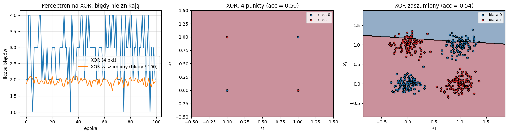
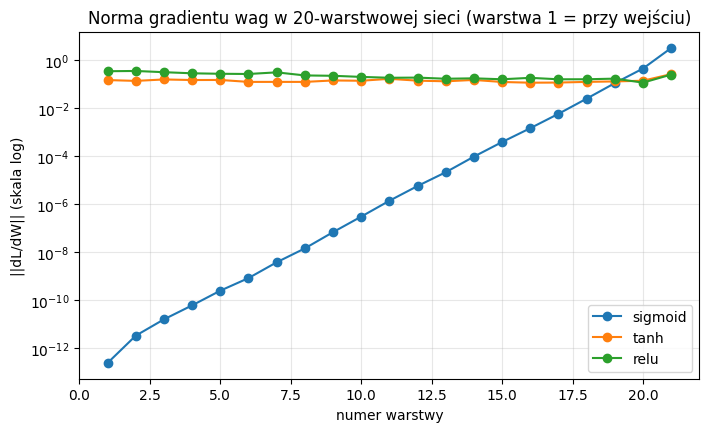
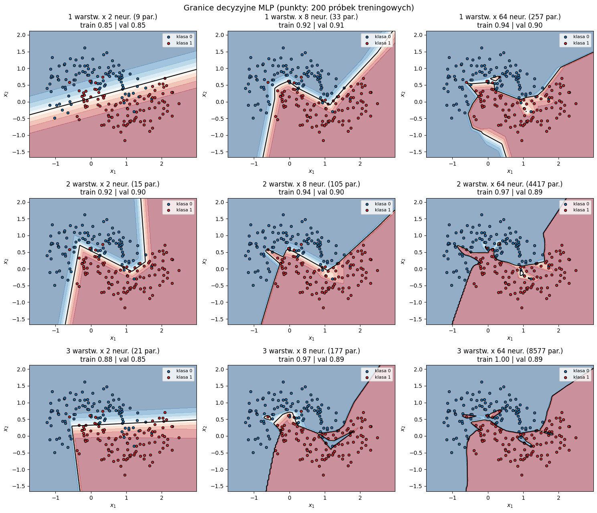

# L2, raport: perceptron, MLP i backpropagation

Notebook: [Lab02_rozwiazanie.ipynb](Lab02_rozwiazanie.ipynb), uruchomiony w Colab na GPU T4. Screeny są w [screeny/](screeny). Z L2 nic nie jest obowiązkowe w sprawozdaniu końcowym, więc to krótkie podsumowanie wyników. Zadanie dodatkowe (spirala w NumPy) jest pominięte.

## Wyniki

| Zadanie | Co zrobione | Wynik |
|---|---|---|
| 1.1 | perceptron Rosenblatta na danych separowalnych | acc 1.00 po 2 epokach |
| 1.2 | perceptron na XOR | acc 0.50 (4 punkty) i 0.54 (zaszumiony XOR) |
| 2.1 | pochodne aktywacji ręcznie vs autograd | różnice do 2.8e−16 |
| 2.2 | znikający gradient w 20 warstwach | stosunek norm warstwa 1 / ostatnia: sigmoid 7.5e−14, tanh 0.56, ReLU 1.4 |
| 3.1 | MLP 2, 4, 1 w NumPy z ręcznym backpropem na XOR | predykcje [0 1 1 0], BCE 0.00047 |
| 3.2 | gradient check ręcznego backpropu | błędy względne rzędu 1e−11 |
| 4.1 | MLP w Keras Sequential na make_moons | val acc 0.980, parametry 337 i 2545 jak w Keras |
| 4.2 | Keras Functional na make_circles | val acc 0.988 |
| 5.1 | ten sam MLP w PyTorch z własną pętlą | val acc 0.988 |
| 6.1 | siatka 3 x 3 architektur | najlepsza 1 warstwa x 8 neuronów (val acc 0.91) |

## XOR i perceptron (zad. 1.2)

Klasy XOR leżą na przekątnych kwadratu, więc żadna prosta ich nie rozdzieli i perceptron nigdy nie przestaje poprawiać wag. Ten sam XOR rozwiązuje już MLP z jedną warstwą ukrytą (zad. 3.1).

## Znikający gradient (zad. 2.2)

Z sigmoidem gradient w pierwszej warstwie jest 13 rzędów wielkości mniejszy niż w ostatniej, bo pochodna sigmoidu to maks. 0.25 i mnoży się przez 20 warstw. Z ReLU i inicjalizacją He gradient zostaje w tym samym rzędzie.

## Pojemność sieci (zad. 6.1)

Na make_moons z szumem 0.3 sieci 1 x 2 i 3 x 2 są niedouczone, a 2 x 64 i 3 x 64 przeuczone (train 0.97 i 1.00, val 0.89). Najlepsza na walidacji jest mała sieć 1 x 8, więc rozmiar sieci wybieram na walidacji, a nie na train.

## Liczba parametrów (zad. 4.1)

Warstwa gęsta ma (n_in + 1)·n_out parametrów. Dla [2, 16, 16, 1] wychodzi 48 + 272 + 17 = 337, a dla [2, 64, 32, 8, 1] wychodzi 192 + 2080 + 264 + 9 = 2545, tak samo jak `count_params()` w Keras. Tak samo policzę architekturę w mini projekcie.
