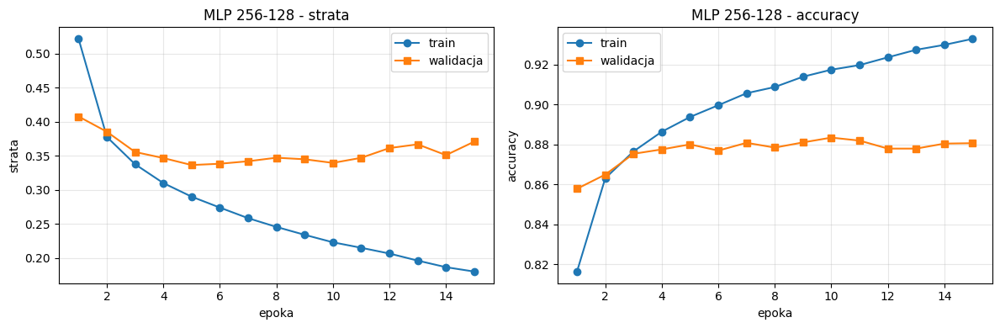
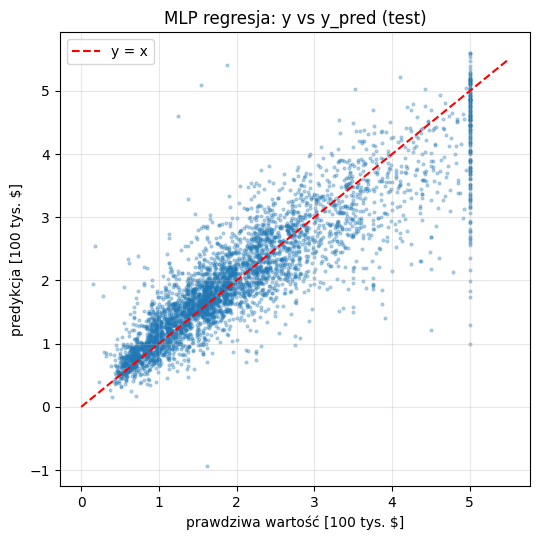
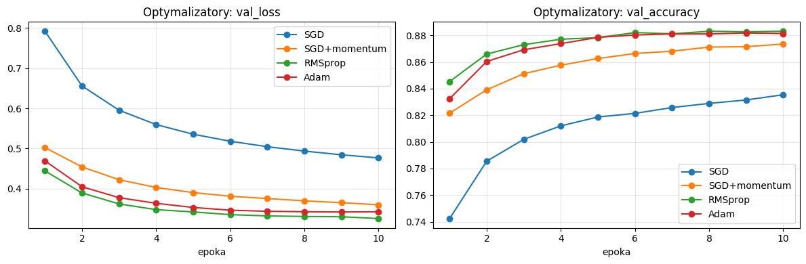
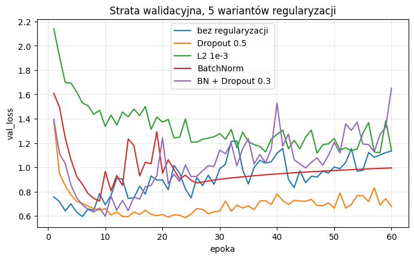

# L3, raport: Keras, klasyfikacja, regresja i regularyzacja

Notebook: [Lab03_rozwiazanie.ipynb](Lab03_rozwiazanie.ipynb), uruchomiony w Colab na GPU T4 (TF 2.21, Keras 3.13). Screeny są w [screeny/](screeny).

## 1. MLP na Fashion-MNIST (zad. 1.1 i 1.2)

Model: Flatten, Dense(256), Dense(128), Dense(10, softmax), 235 146 parametrów (ręcznie wyszło tyle samo). Test acc **0.871**, najlepsza val acc 0.883. Najmniejszy val_loss jest w 5. epoce (0.337), potem val_loss rośnie do 0.371, a train loss dalej spada. Przeuczenie zaczyna się więc od ok. 6. epoki.

Najczęściej mylona para to T-shirt/top uznany za Koszulę (173 razy), a najgorzej rozpoznawana klasa to Sweter (0.66). To ubrania o prawie tym samym kształcie, a w 28x28 nie widać detali.

## 2. Regresja California Housing (zad. 2.1 i 2.2)

| Model | MAE | RMSE |
|---|---|---|
| średnia z train | 0.905 | 1.145 |
| regresja liniowa | 0.533 | 0.750 |
| MLP (64, 64) | **0.360** | **0.533** |

Pionowa kreska przy 5.0 to ceny obcięte w danych do 500 tys. $ (184 domy w teście). Prawdziwa cena tych domów może być wyższa, więc model nie ma jak się jej nauczyć i takie domy zaniża.

Callbacki (zad. 3.1): lr zmalał 7 razy, od 1e−3 do 1e−5, ale EarlyStopping się nie włączył i trening doszedł do limitu 200 epok, bo przy małym lr val_loss dalej spadał o drobne ilości. Wczytany `najlepszy_reg.keras` ma MAE 0.366.

## 3. Optymalizatory (zad. 4.1 i 4.2)

| Optymalizator | najlepsza val acc | epoka |
|---|---|---|
| SGD lr 0.01 | 0.835 | 10 |
| SGD + momentum 0.9 | 0.874 | 10 |
| RMSprop lr 0.001 | 0.883 | 8 |
| Adam lr 0.001 | 0.882 | 9 |

Zwykły SGD jest wyraźnie najwolniejszy, bo robi krok tylko z bieżącego gradientu przy stałym lr. Momentum sumuje kroki w jednym kierunku, a RMSprop i Adam dopasowują krok osobno do każdego parametru, więc dochodzą do 0.88 już w 8. i 9. epoce. Dla Adama lr = 0.1 jest za duży (strata stoi koło 1.0, val acc 0.615), a 1e−4 za mały (po 10 epokach strata 0.39 zamiast 0.26).

## 4. Regularyzacja (zad. 5.1 i 5.2)

Duży MLP (3 x 512, 932 362 parametrów) na 1000 obrazach, 60 epok.

| Wariant | najlepsza val acc | val acc na końcu | luka train i val acc | min val_loss | val_loss na końcu |
|---|---|---|---|---|---|
| bez regularyzacji | 0.817 | 0.817 | 0.183 | 0.595 | 1.135 |
| Dropout 0.5 | **0.818** | **0.818** | **0.112** | **0.586** | **0.678** |
| L2 1e−3 | 0.812 | 0.786 | 0.164 | 1.117 | 1.144 |
| BatchNorm | 0.813 | 0.813 | 0.187 | 0.722 | 0.995 |
| BN + Dropout 0.3 | 0.808 | 0.752 | 0.243 | 0.597 | 1.652 |

Val_loss dla L2 zawiera karę za wagi, więc nie porównuję go wprost z resztą.

**Hipoteza:** BN przyspieszy trening, ale słabiej ograniczy przeuczenie niż Dropout, a najlepszy będzie BN z Dropoutem 0.3.

**Weryfikacja:** pierwsza część się potwierdziła, bo sam BN zostawił lukę 0.187, czyli tyle co bez regularyzacji. Szybszego treningu z BN nie widać. Druga część się nie potwierdziła: BN z Dropoutem wypadł najgorzej (luka 0.243, val_loss skacze do 1.65). Najlepszy jest sam Dropout 0.5. Przy 1000 obrazach i batchu 64 statystyki BN są zaszumione, a Dropout dokłada jeszcze szumu.

## 5. Propozycja usprawnienia

W regresji z callbackami dodałbym `min_delta=1e-4` do EarlyStopping albo zamiast ReduceLROnPlateau dał harmonogram CosineDecay. Wtedy trening skończyłby się po kilkudziesięciu epokach zamiast 200, a wynik byłby praktycznie taki sam (MAE 0.366 i 0.360 to prawie to samo). W klasyfikacji Fashion-MNIST większy zysk da zamiana MLP na sieć splotową, bo MLP nie widzi sąsiedztwa pikseli. W L4 prosta CNN doszła na tych samych danych do 0.910.
