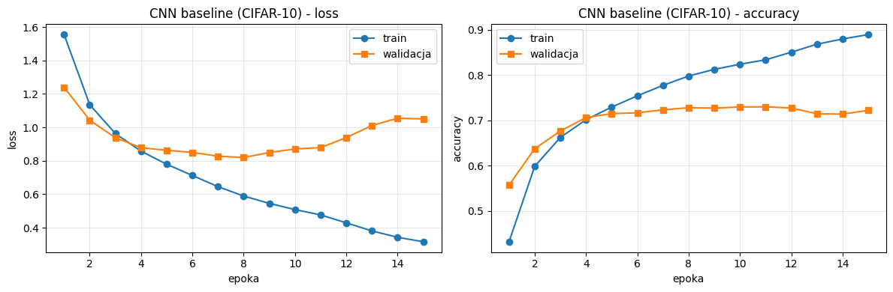
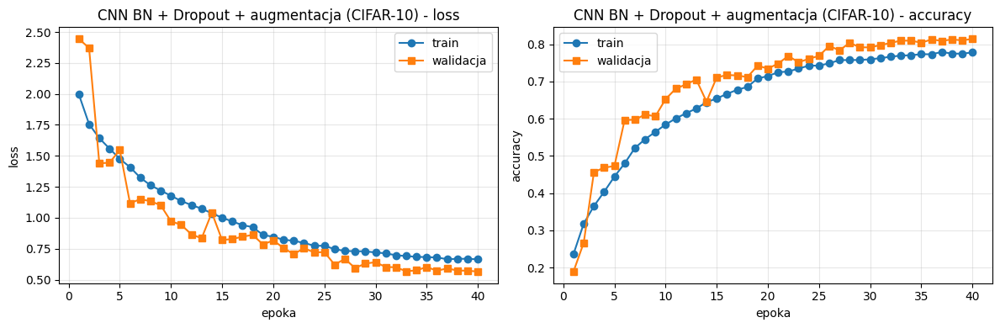
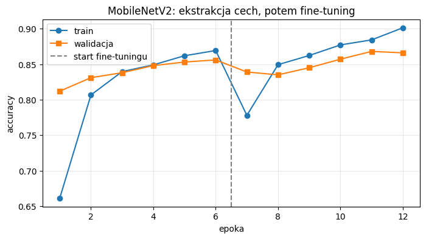
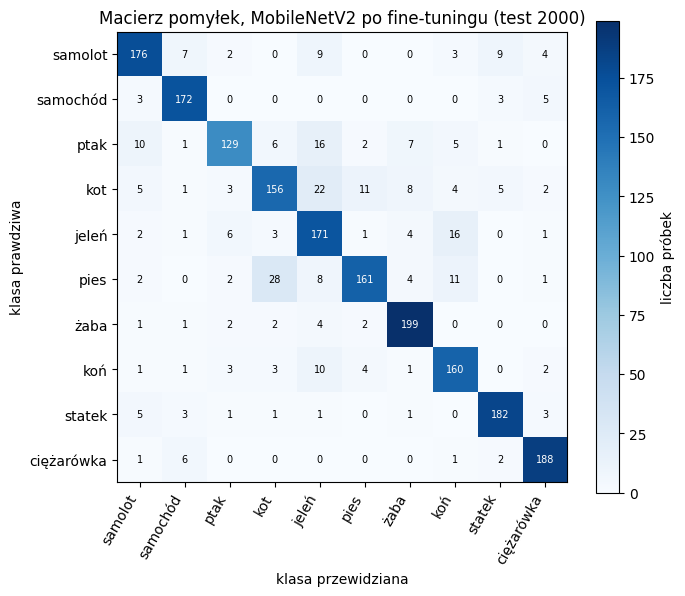
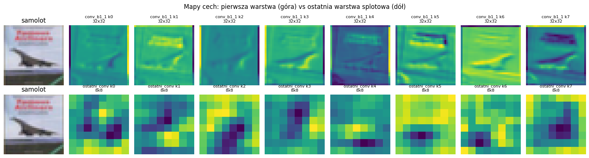

# L4, raport: sieci splotowe (CNN) i transfer learning

Notebook: [Lab04_rozwiazanie.ipynb](Lab04_rozwiazanie.ipynb), uruchomiony w Colab na GPU T4 (TF 2.21, Keras 3.13). Screeny są w [screeny/](screeny). Zadanie dodatkowe (Grad CAM) jest pominięte.

## 1. MLP vs CNN na Fashion-MNIST (zad. 2.1)

| Model | parametry | test acc | czas treningu |
|---|---|---|---|
| MLP 256, 128 (z L3) | 235 146 | 0.875 | 25 s |
| CNN (2 x Conv + MaxPool, Dense 128) | 421 642 | **0.910** | 42 s |

**Hipoteza:** CNN będzie dokładniejsza niż MLP i będzie miała mniej parametrów, bo filtry są współdzielone.

**Weryfikacja:** pierwsza część się potwierdziła (0.910 wobec 0.875). Druga nie: CNN ma prawie 2 razy więcej parametrów, bo same sploty mają tylko 320 i 18 496 wag, a 401 536 siedzi w Dense(128) po Flatten (mapa 7x7x64 to 3136 liczb).

## 2. CIFAR-10: baseline vs BN, Dropout i augmentacja (zad. 3.1)

Baseline (3 sploty, bez regularyzacji) szybko się przeucza: minimum val_loss jest w 8. epoce, potem val_loss rośnie, a na końcu train acc 0.89 przy val acc 0.72 (luka 0.167). Model z BatchNorm, Dropoutem i augmentacją nie ma tej luki (−0.037, val acc jest nawet wyższa od train, bo augmentacja i Dropout działają tylko w treningu), a test acc wzrosła z 0.708 do 0.800. Val_loss spadał do ostatniej, 40. epoki, więc dłuższy trening pewnie dałby jeszcze trochę więcej.

## 3. Wszystkie modele na CIFAR-10 (zad. 6.3)

| Model | parametry | trenowalne | test acc | obrazy treningowe | zbiór testowy |
|---|---|---|---|---|---|
| CNN baseline | 356 810 | 356 810 | 0.708 | 45 000 | 10 000 (cały test) |
| CNN BN + Dropout + aug | 552 362 | 551 466 | 0.800 | 45 000 | 10 000 (cały test) |
| mini ResNet z GAP | 310 026 | 308 682 | 0.792 | 45 000 | 10 000 (cały test) |
| MobileNetV2, zamrożona baza | 2 270 794 | 12 810 | 0.832 | 9 000 | 2 000 (losowy podzbiór) |
| MobileNetV2, fine tuning 30 warstw | 2 270 794 | 1 539 210 | **0.847** | 9 000 | 2 000 (losowy podzbiór) |

**Uwaga:** modele CIFAR są liczone na całym zbiorze testowym, a MobileNetV2 na losowym podzbiorze 2000 obrazów, więc porównanie nie jest w pełni uczciwe. Mimo to transfer learning na 5 razy mniejszym zbiorze treningowym wygrywa z każdą siecią uczoną od zera. Mini ResNet ma 1.8 razy mniej parametrów niż model z 3.1 przy prawie tej samej dokładności, bo GlobalAveragePooling zastępuje Flatten i dużą warstwę Dense. Fine tuning dał tylko +1.6 pp.

## 4. Macierz pomyłek modelu transferowego

Najczęściej mylone pary to kot z psem (39 razy) i jeleń z koniem (26 razy). To czworonogi o podobnym kształcie i kolorze, a w 32x32 (nawet po powiększeniu do 96x96) nie widać pyska ani rogów. Najsłabszy recall mają kot (0.72), ptak (0.73) i pies (0.74), a najlepszy ciężarówka, żaba i samochód (0.94 do 0.95).

## 5. Mapy cech (zad. 5.1)

Mapy z pierwszej warstwy (32x32) wyglądają jak obraz po filtrze: widać krawędzie skrzydeł i kadłuba samolotu. Mapy z ostatniej warstwy (8x8) są dla człowieka nieczytelne, ale każdy ich piksel ma duże pole recepcyjne i reaguje na większe wzorce.

## 6. Propozycja usprawnienia

Największy zysk dał transfer learning, więc tam bym szukał dalej. Wejście 96x96 to najmniejsza rozdzielczość dla wag ImageNet MobileNetV2, a obrazy CIFAR po powiększeniu dalej są rozmyte. Spróbowałbym rozdzielczości 128 albo 160 i modelu EfficientNetB0 z `keras.applications` oraz uczenia na całym CIFAR-10 zamiast 9000 obrazów. Dla sieci od zera wystarczyłoby dać więcej epok, bo model z 3.1 przy 40 epokach jeszcze się nie zatrzymał.
